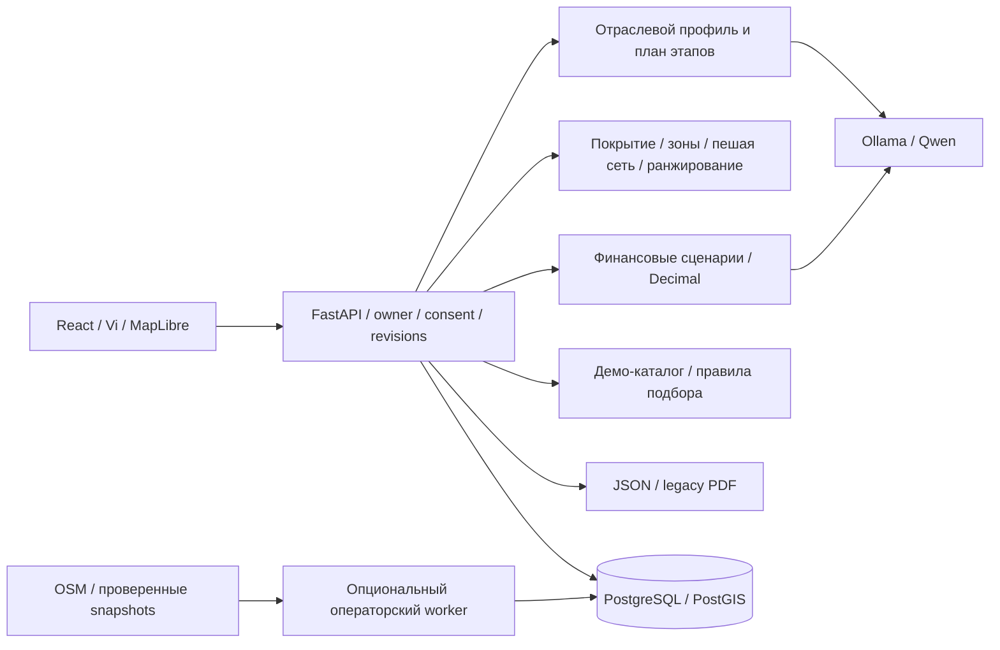

# Архитектура

Приложение — модульный монолит FastAPI с React-клиентом и PostgreSQL/PostGIS. Это фактическая структура снимка после интеграции U-06.

## Клиент и API

`apps/web/src` содержит диалог, Vi, отраслевые и финансовые экраны, банковский шаг и результат. Vite используется для разработки; контейнер web обслуживает сборку через nginx и проксирует API. Состояние и права определяет сервер: история браузера хранит только предпочтение навигации. Гостевой токен связывает запросы с владельцем диалога; отдельные согласия ограничивают операции.

`apps/api/app` разделён на API-контракты, сервисы диалогов, industry, finance, geo, data, bank/leads, reports и ограничители запросов/инференса. Legacy `/api/v1` сохраняется рядом с отраслевыми `/api/v2` операциями. Оптимистические версии и блокировки защищают профиль и финансовые входы от устаревших записей.

## Модель и инструменты

Ollama — отдельный локальный процесс; модель по умолчанию `qwen3:4b-instruct-2507-q4_K_M`. Qwen предлагает структурированные уточнения, классификацию и финансовые гипотезы. Типизация, ограничения и подтверждение пользователя остаются на сервере. Финансовые формулы не исполняются моделью. Общая очередь ограничивает инференс. Флаг `BA_AGENT_ENABLED` отдельно включает ограниченный инструментальный API; обычный диалог не запускает его автоматически.

## Данные и аналитика

PostGIS хранит версионированные OSM POI, границы и пешую сеть. Покрытие оценивается по области и метаданным набора; зона-кандидат, walking catchment и ранжирование используют локальные данные. Реестр источников хранит происхождение, лицензию, даты и пригодность. GHSL и licensed-адаптеры не имеют подключённых наборов. Синтетический провайдер включается и импортируется явно.

Операторская загрузка имеет отдельные разрешения, лимиты, jobs/events, leases и fencing. `compose.acquisition.yaml` добавляет worker; он не нужен для базового запуска и не предоставляет гостю произвольный downloader.

## Финансы, банк и результаты

Отраслевой план выбирает применимые этапы. Финансовый workspace связан с подтверждённой ревизией профиля; входы имеют единицы, происхождение, диапазоны и состояние проверки. Детерминированные адаптеры считают три сценария, безубыточность и чувствительность. Сохранённые результаты неизменяемы. Правка профиля или входов скрывает устаревший результат из текущего представления. Receipts фиксируют состояние длительного действия, отмену и прерывание.

Банковский matcher применяет правила к потребностям и демонстрационному каталогу. Подбор информационный; скоринга и внешней передачи нет. Legacy mock-заявки требуют отдельных согласий; для новых отраслей они недоступны.

`analysis-result-v2` объединяет текущий финансовый snapshot и живую оценку применимости/покрытия с `assessed_at`. JSON использует этот результат. Legacy PDF/JSON сохраняются отдельными immutable-отчётами; PDF новых отраслей не реализован.

## Хранение

SQLAlchemy описывает модели в `app/db/models.py`, Alembic — изменения схемы в `migrations/versions`. БД хранит диалоги, профили, согласия, источники/геометрию, отчёты, отраслевые документы, задания, действия и финансовые snapshots. [Миграции](MIGRATIONS.md), [контракты](DATA_CONTRACTS.md), [ограничения безопасности](SECURITY_AND_LIMITATIONS.md).
